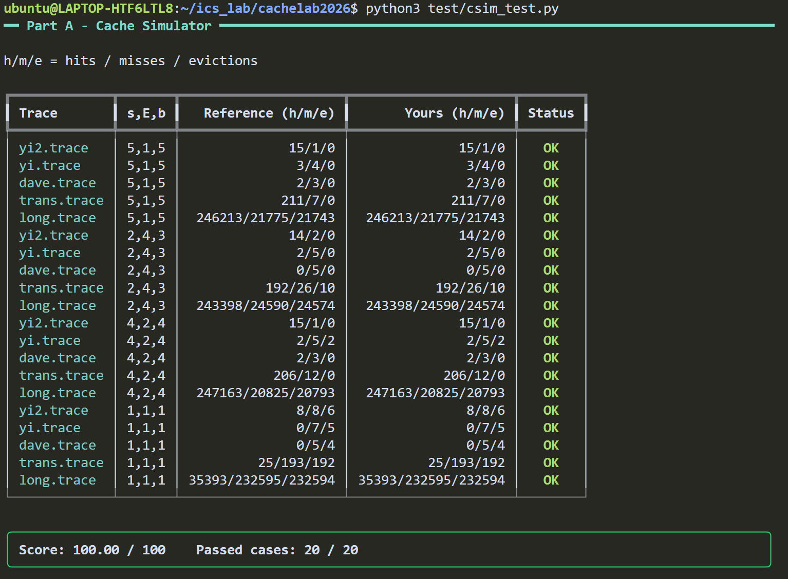
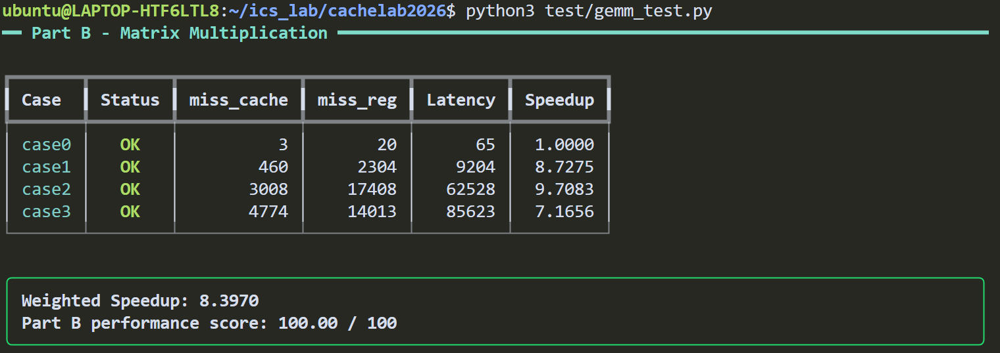
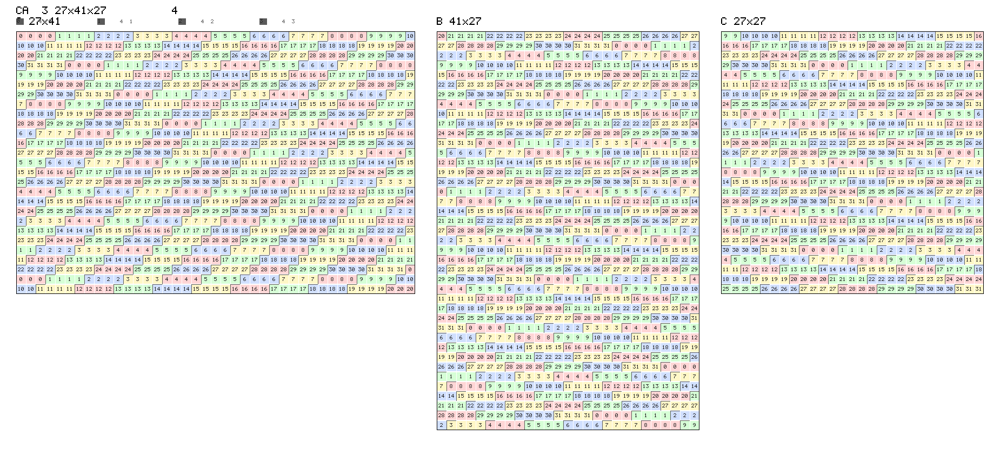

# CacheLab 报告

姓名：邹承鹏

学号：2025201915

| csim 分数（/100） | case1 speedup | case2 speedup | case3 speedup | weighted speedup | Part B 性能分（/100） |
| ---------------- | ------------- | ------------- | ------------- | ---------------- | ------------------- |
| 100.00 | 8.73 | 9.71 | 7.17 | 8.40 | 100.00 |

<!-- 保留两位小数，四舍五入 -->

本地评测截图：

## Part A: cache 模拟器

### 实现简述

用 C++ 实现（`csim.cpp`），建立2个class: `LRU`, `Cache`。

**地址拆分**：`tag = addr >> (s+b) << (s+b)`，`set = (addr >> b) & (2^s - 1)`。

**LRU**：维护 `vector<int64_t>` v，最大容量 `e`，现有容量 `valid_size`，保留 `static inline int hits, misses, evictions`。每次读取时运行函数 `LRU::put(int64_t tag)`，命中时把对应 `tag` 移动到头，其余往后；未命中时先检查容量是否已满，未满就把所有后移，满了就把除了最后一个后移（最后一个被覆盖），再头插 `tag`（这里用双链表加 hash 更快，但是感觉太浪费存储了，没必要，本身也就 `O(E)`，问题不大），同时统计3个待求的参数。

**Cache**：维护 `vector<LRU>` `LRU_list`，参数 `s`, `b`，操作为 `Cache::operation(int64_t addr)`，传入 `addr`，然后拆分得到在 `list` 中的位置 `idx`，以及 `tag`，然后执行 `put()`。

**读取数据**：每次读一行，送进 `sscanf()`，得到需要的值。

### 亮点

- 每次访问是 `O(E)`，均衡时间空间（至少我觉得均衡了）

## Part B: 矩阵乘法优化

### 亮点
0. 着重优化cachemiss。
1. **分块**：对C分块4\*4（case3是4\*6），每次开寄存器存16个C的元素，计算完成这16个后一并写回C，减少C的读取以及Cachemiss。计算的时候的小单元是A的4行乘以B的四列。
2. **每轮取2列A**：减少A的访存次数（50%）。
3. **提前取下一轮的A**：在 B 的访问之前，把下一轮行 0、1 需要的 A 值提前取进寄存器，这样减少0,1行被踢出去导致的cachemiss。
4. **遍历反向**：C是先行后列，于是两次之间A的行没变，这样一轮完了之后反向遍历的时候，A最后那个位置的块还在cache里面，这样可以减少cachemiss。
5. **枚举单元大小**：case3啥都不连续，直接枚举得到最好的结果（其实感觉可以把AB的尺寸给padding成4的倍数，padding多的地方填0，最后截断，但是不能改ABC内存，buffer也不够，而且小矩阵运输成本很高，就没自己写一个模拟系统来测）

#### 我认为的最优秀的实现排序

1. case1
2. case2
3. case3

### case1

| 指标 | 数值 |
|---|---|
| `miss_cache` | **460** |
| `miss_reg` | **2304** |
| latency | **9204** |
| speedup | **8.73×** |

cachemiss：A 148 次、B 248 次、C 64 次。

**理论分析**： A、B、C 各 64 条 cache 行。

- **C**：64，一致
- **B**：每遍历一遍都必须把 B 整个放cache，共4次，合计 256。实测 248，略低可能是因为块列之间有少量跨块复用
- **A**：A每次读取，然后会被B踢掉一堆，然后再进入下一轮循环，大概64*3=192左右，实际也是，之后经过2次的优化要好些

**为什么一次取2列A** `A[i][k]` 与 `A[i][k+1]` 在同一块cache里。每轮取 2列，减少本来取第二列被B踢掉的cachemiss（当然，取4列是最好的，这样A被踢了也没事但是寄存器显然不够，如果有多级缓存的话感觉这里是个优化的点，当然这又是另外一段故事了...）

**提前取下一轮的A** 一轮的顺序是"读 A（4 条行）→ 读 B → 乘加"。如果 A 与 B 在这个块里撞同样的 4 个cache块，这样的话 B 一读，A 的 4 块就没了，而下一轮要用的 A 值恰好在同一块的另外两个 int 上，于是在读 B 之前先把它们取走，等下一轮要用时，值就已经在寄存器里了。

**反向遍历** A 全部占16块cache块，占 cache 的一半，所以一块结束时 A 的行还有大量残留。让下一轮的时候从同一端开始，就可以直接命中这些残留。

**每一步的收益**（同一份代码逐步演进）：

| 版本 | `miss_cache` | speedup |
|---|---|---|
| baseline | 4792 | 1.00× |
| 4×4 分块 + 16 累加器 | 496 | 8.24× |
| 改为每轮 2 列 | 488 | 8.35× |
| + 行 0,1 跨轮预取 | 472 | 8.56× |
| + 反向遍历 | **460** | **8.73×** |

### case2

| 指标 | 数值 |
|---|---|
| `miss_cache` | **3008** |
| `miss_reg` | **17408** |
| latency | **62528** |
| speedup | **9.71×** |
| 寄存器峰值 | 36 |

cachemiss：A 704、B 2048、C 256

结构全同 case1 ，不再赘述。

**为什么这里没有反向遍历**  这里一个矩阵占32块cache块，正好等于整个 cache 的容量。块结束时 C 写回把A的缓存全干掉了。

| 版本 | `miss_cache` | speedup |
|---|---|---|
| 4×4 分块，每轮1列 | 3200 | 9.28× |
| 每轮 2 列A | 3136 | 9.42× |
| + 行 0,1 跨轮预取 | **3008** | **9.71×** |

### case3

| 指标 | 数值 |
|---|---|
| `miss_cache` | **4774** |
| `miss_reg` | **14013** |
| latency | **85623** |
| speedup | **7.17×** |
| 寄存器峰值 | 36 |

cachemiss：A 1604、B 2888、C 282

miss多大致是因为 case3 的形状是 27×41×27，两个 stride（41 和 27）都是奇数，直接把全部对应的cache打乱了，而且ABC地址连续进一步打乱了对应的cache，导致撞击有种随机性的感觉。但有一点想法：由于cache块对应的内存是按行来分的，那么按理来说分块的尺寸越大效果越好（当然是非标准4的倍数的情况下），实际枚举中也能应证这一点。

目前没想到什么好方法（除了那个反向遍历，还有那个padding+移动，后者没法测，但我估计效果不太行，可能大矩阵效果要好些），直接枚举分块得到结果（4\*6分块）。

| 版本 | `miss_cache` | `miss_reg` | speedup |
|---|---|---|---|
| 4×4 分块| 6067 | 16227 | 5.72× |
| 改为 4 行 × 6 列 | 5003 | 14013 | 6.89× |
| + 反向遍历 | **4774** | **14013** | **7.17×** |

## 反馈/收获/感悟/总结（这一部分应该不用太正式吧...）

PartA挺简单的，20mins就做完了，没什么好说的，但是有个小问题，似乎没说verbose模式要干什么，我就随便写了一个意思一下。

PartB需要大量的思考，而且重构方案的时候特别麻烦（额，调了10版方案之后写不动了，让AI帮我写的代码...），我认为在我这个分块思路的框架下应该做的不错了，一共做了一天多（周一晚10:00-周二晚11:30，除了吃饭睡觉英语课应该都在想...是不是暴露了完全没认真听课...），最后加速8.4（不知道是不是这个框架下的顶点，应该有大佬更强吧...但是如果把B,C,buffer给干掉，多3个寄存器的话任务3可以加速到7.84，最后总的是8.67，比较厉害，但是代码3000行...就算了）。

（然后让AI搞了一版，10几分钟9.3，man what can i say? 我不知道我还有什么意义...哎，就这样吧。但是AI的框架思路跟我的完全不一样，好吧，也改不了AI把我按在鞋底的事实。哎，有种以后要被AI干掉的预感...当然，提交的是我自己想的版本）

至于其他方面，提示很有用，但是buffer这个目前没想到在这3个cases有什么用处。因为这个是魔改过的cachelab，不是一般的转置，确实感觉没什么参考，我去b乎看了一圈还有A佬的cachelab blog也没看到什么比较好的建议，主要原因应该是这3个矩阵太爱撞了...到处乱撞...cache被踢走的太多了。我自己想到的2个提速方案感觉还是有意义的。后来搜索了一下，好像都是前人想出来过的，一个叫预取，另一个叫什么蛇形遍历。额，哎，AI也比不过，然后被前人给斩了...

## 参考的重要资料

1. 本实验的readme

2. https://zhuanlan.zhihu.com/p/387662272
这个其实跟我的方案没有任何关系，但是看到他的动图的时候我突然想到了预取的思路，老实看图，很枯燥吧。（这个是转置cachemiss达到理论下界的方案，确实值得一看）